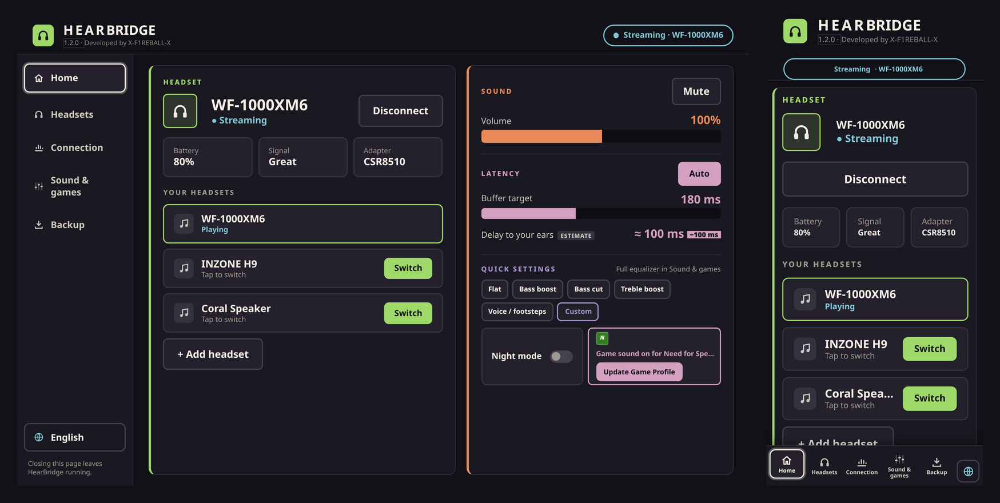
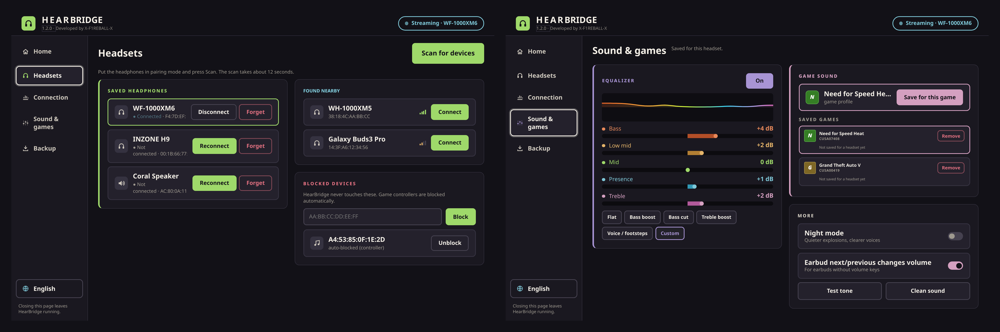

<div align="center">


**Bluetooth audio for a jailbroken PS4: your game sound on regular wireless headphones.**

Developed by **X-F1REBALL-X**

</div>

**HearBridge family:** [PS5](https://github.com/X-F1REBALL-X/HearBridge-PS5) · [PS4](https://github.com/X-F1REBALL-X/HearBridge-PS4) · [Browser](https://github.com/X-F1REBALL-X/HearBridge-Browser)


HearBridge PS4 plays your PS4's game audio on ordinary Bluetooth headphones, earbuds or speakers. The console cannot do this by itself, so HearBridge drives a small USB Bluetooth dongle (CSR8510 or Realtek RTL8761BU) and streams to any A2DP headset. You control everything from a web page served by the console, on a phone, a PC or the PS4 browser. It is the first Bluetooth audio solution for the PS4.





## Downloads

There are two packages on the [Releases](https://github.com/X-F1REBALL-X/HearBridge-PS4/releases) page. Both are version 1.2.0.

| Package | Works on |
|---|---|
| `HearBridge-PS4-1.2.0-for-14.xx.pkg` | All firmwares, including 14.00 to 14.02. Use this one if you are not sure. |
| `HearBridge-PS4-1.2.0-up-to-13.52.pkg` | Up to 13.52. Runs the service through BinLoader from the home screen. |

## What it does

- Game audio on any Bluetooth headphones, earbuds or speakers.
- Scan, pair and connect from a web page. Up to 8 saved headsets, with automatic reconnect.
- One volume meter from 0 to 200. Up to 100 it is the normal volume, above 100 it boosts quiet games (up to x5). It starts at 100.
- Five band equalizer with presets (Bass boost, Voice / footsteps, Treble boost and more) and a Night mode that keeps explosions down and voices clear.
- Game profiles: save the sound you like for a game and it comes back every time that game starts.
- Codec choice: plain SBC, SBC HQ, or SBC-XQ on headsets that support it.
- Latency setting: Auto, or pick a buffer yourself (lower means less delay, higher means fewer dropouts).
- Battery level for headsets that report it, Sony earbuds included.
- Live status: link quality, signal, packets, audio peaks and the game that is running, with its artwork.
- Two dongles at once: Auto prefers the USB stick when one is plugged in, or pick one yourself.
- Backup and restore of saved headsets, pairings and settings, to the console or a USB drive.
- Earbud next/previous buttons can change the volume, for earbuds without volume keys.
- Turning the headphones off or putting them in the case disconnects them cleanly.

## What's new in 1.2.0

- New web page with Headsets, Sound & games, Connection and Backup tabs.
- Works on firmware 14.00 to 14.02 (see below).
- The package installs all plugins by itself. No FTP, no editing files.
- Unified volume meter with boost, starting at 100.
- SBC HQ and SBC-XQ, battery level, latency control, dual dongle support and backups.
- Faster start screen.

## Requirements


- A jailbroken PS4 running GoldHEN with Plugin Loader turned on. The 13.52 package also needs BinLoader server.
- A USB Bluetooth dongle plugged into the PS4, either:
  - **CSR8510** (USB ID `0A12:0001`). It looks like the one on the right. No extra firmware is needed.
  - **Realtek RTL8761BU**, including rebadged sticks such as TP-Link UB500 / UB600 (`0BDA:B00C` / `0BDA:8771`) and ASUS BT600. The chip is detected from the stick itself, not only the USB id. Firmware is bundled in the package and written to `/data/hearbridge/firmware/` on start.
- Bluetooth headphones, earbuds or a speaker.

<br clear="right">

## Install

1. Install the package for your firmware with GoldHEN's package installer. A **HearBridge** tile appears on the home screen.
2. In the GoldHEN settings, turn on **Plugin Loader** (and **BinLoader server** if you use the 13.52 package).
3. Plug the dongle into the PS4 and open the **HearBridge** tile. It copies the plugins into `/data/GoldHEN/plugins`, adds them to `plugins.ini` and starts the service.
4. Open **http://&lt;console-ip&gt;:8090** on a phone or PC on the same network. Or press OK on the tile message and then X (Circle if your console is set that way) to open the page in the PS4 browser.
5. Press **Scan for devices**, put your headphones in pairing mode and tap **Pair**. Only headphones, earbuds and speakers show up in the list, so if yours are missing, make sure they are really in pairing mode.
6. Start a game. The sound plays on your headphones.

HearBridge keeps running after the tile closes and reconnects to your last headphones by itself. Restarting the console once after the first install is recommended.

## How the 14.xx package works

On 13.52 the launcher sends the HearBridge service to GoldHEN's BinLoader and it runs in the background. GoldHEN does not officially support 14.00 to 14.02 yet. On those firmwares its BinLoader accepts the file but never runs it, so that path is dead. GoldHEN plugins still work there, so the 14.xx package uses them instead. This works on every firmware GoldHEN supports:

- `hearbridge_game_tap.prx` picks up the game's audio, same as before.
- `hearbridge_boot.prx` loads with every game and starts the service (`hearbridge_daemon.prx`) inside the game process.
- The game tap hands audio straight to the service in the same process, without going through the network.

The result is the same as on 13.52: headphones, the web page and game sound, with no extra jailbreak step. The difference is that on 14.xx the service starts when a game opens, not from the home screen.

## Launcher

<p align="center"></p>

## Your controller stays connected

HearBridge does not affect your controller. The Bluetooth audio goes through the separate USB dongle, and HearBridge never touches the console's built-in Bluetooth chip, so your controllers stay connected as usual. Pairing is shared across CSR and Realtek sticks: a headset paired on one should reconnect on the other (a CSR stick may need one unplug/replug after the first time the shared address is saved).

## Good to know

- Bluetooth adds a little delay, so the headphones play slightly behind the TV.
- Only game audio is streamed, not the home screen sounds or voice chat.
- Game audio is picked up from a game's main and background music outputs when they run at 48 kHz, which is what almost all games use. A game that opens its audio at another rate is not streamed.
- The launcher turns on **Plugin Loader** in GoldHEN's `config.ini` and adds the HearBridge plugins to `plugins.ini` under `[default]`. The first time it changes either file it keeps a copy as `config.ini.bak` or `plugins.ini.bak` next to it. It adds the lines again if you remove them.
- The page can be controlled by anyone who can open it on your network, so use it on a home network you trust. Commands only work from the page itself, not from other web sites.

## Uninstall

Delete the **HearBridge** app from the PS4. To remove everything it left behind, also delete these files from `/data/GoldHEN/plugins`: `hearbridge_game_tap.prx`, `hearbridge_boot.prx`, `hearbridge_daemon.prx` and any other HearBridge file there, and their lines in `/data/GoldHEN/plugins.ini`. Then delete the folders `/data/hearbridge` and `/data/GoldHEN/hearbridge`, and the files `hearbridge_skip.txt` and `hearbridge_tap_off` in `/data/GoldHEN`. Restart the console to stop a running HearBridge service.

## Build

You need the OpenOrbis PS4 toolchain, the PS4 payload SDK and the GoldHEN plugins SDK, and `clang`, `ld.lld` and Python 3. Point three variables at them:

```sh
export OO_PS4_TOOLCHAIN=/path/to/OpenOrbis/PS4Toolchain
export PS4_PAYLOAD_SDK=/path/to/ps4-payload-sdk
export GOLDHEN_SDK=/path/to/GoldHEN_Plugins_SDK
make launcher   # build/launcher/IV0000-HRBG40001_00-HEARBRIDGEPS4000.pkg
make test       # host tests, no SDK needed
```

The package also contains three system modules (`libc.prx`, `libSceFios2.prx` and `right.sprx`). They are not in this repository: the build copies them from the OpenOrbis toolchain (`src/modules` and `samples/dialogs`). If your toolchain keeps them elsewhere, set `SYS_LIBC`, `SYS_FIOS2` and `SYS_RIGHT` to their paths. `PkgTool.Core` needs OpenSSL 1.1; if your system has only a newer one, set `LIBSSL11` to a directory with `libssl.so.1.1`.

`make payload` builds the service alone and `make game-tap` the game audio plugin. `make -C plugin boot daemon` builds the two plugins used on 14.xx. Add `TITLE='HearBridge 14.xx'` to the launcher build for the 14.xx package.

## Credits

Developed by **X-F1REBALL-X**. The equalizer comes from [HearBridge PS5](https://github.com/X-F1REBALL-X/HearBridge-PS5). The Realtek ROM-mode firmware loader, chip identity tables and bundled RTL8761BU blobs were ported from HearBridge PS5 (USB path and Realtek detection by [jamesst20](https://github.com/jamesst20)).

Bundled RTL8761BU firmware blobs are from the [linux-firmware](https://git.kernel.org/pub/scm/linux/kernel/git/firmware/linux-firmware.git/tree/rtl_bt) `rtl_bt` tree (Realtek Semiconductor Corporation). See [assets/firmware/LICENCE.rtlwifi_firmware.txt](assets/firmware/LICENCE.rtlwifi_firmware.txt). Built with the OpenOrbis PS4 toolchain, the PS4 payload SDK and the GoldHEN plugins SDK. The system modules in the package belong to the OpenOrbis toolchain and are not covered by this project's license.

Big thanks to SiSTR0 for creating GoldHEN. HearBridge would not be possible without it.

Thank you to WOOfer for the coffee.

## License

GPL-3.0-or-later. See [LICENSE](LICENSE) and [NOTICE](NOTICE).
